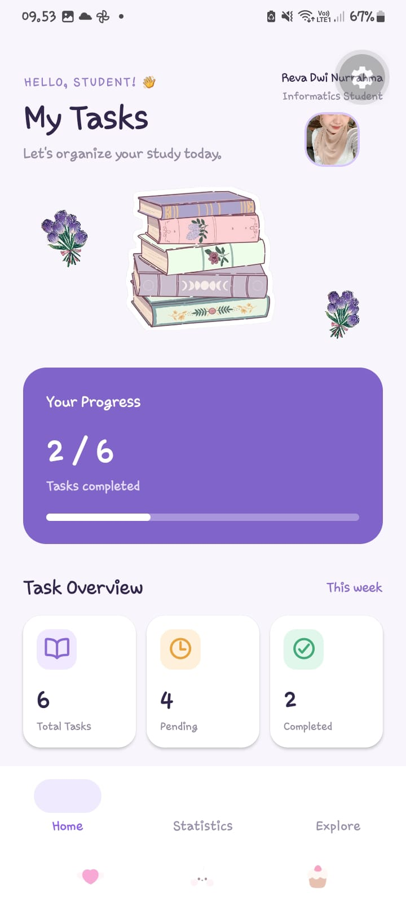
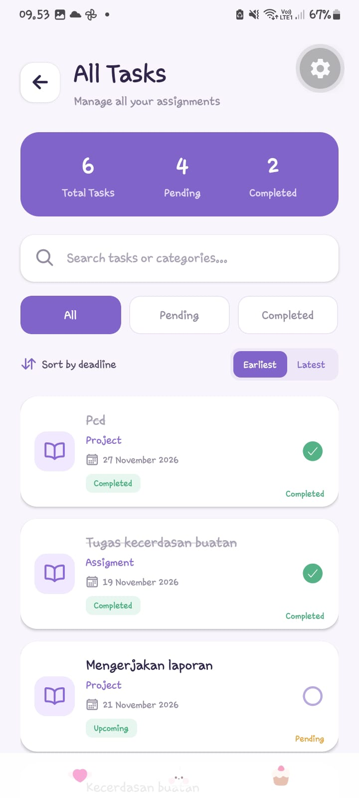
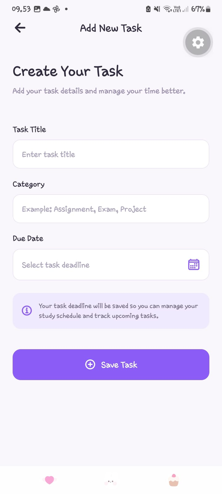
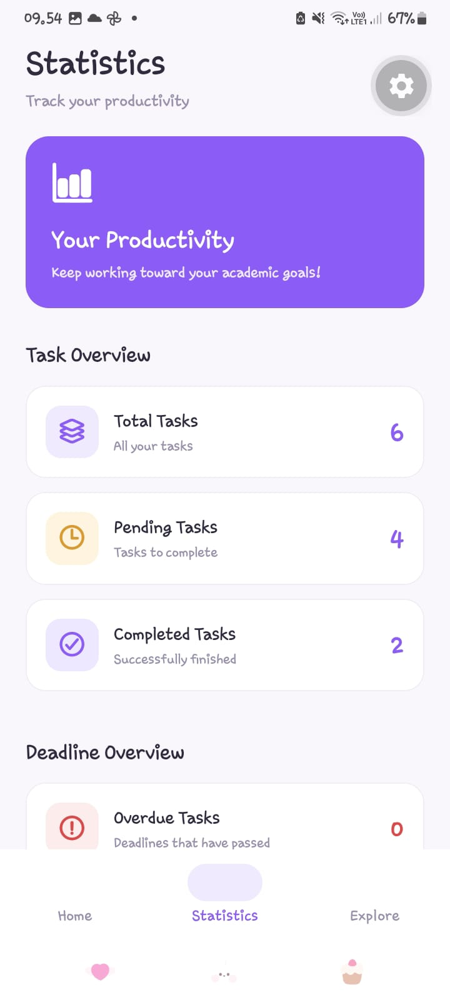
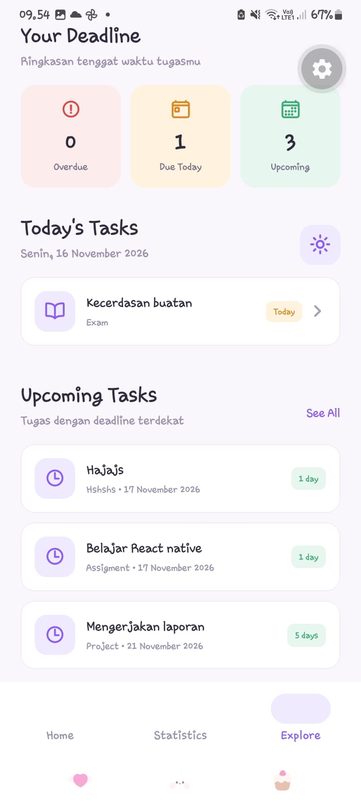

# Student Task Manager

Student Task Manager adalah aplikasi manajemen tugas mahasiswa berbasis mobile yang dikembangkan menggunakan React Native dan Expo. Aplikasi ini membantu mahasiswa mengatur tugas kuliah, memantau tenggat waktu, serta melihat perkembangan penyelesaian tugas dengan tampilan yang sederhana dan menarik.

## Fitur Aplikasi

- **Dashboard:** Menampilkan ringkasan jumlah tugas, tugas selesai, tugas yang belum selesai, dan progres pengerjaan.
- **Tambah Tugas:** Menambahkan tugas baru dengan judul, kategori, dan tanggal tenggat.
- **Kelola Tugas:** Melihat detail, mengedit, dan menghapus tugas.
- **Status Tugas:** Mengubah status tugas menjadi selesai atau belum selesai.
- **All Tasks:** Menampilkan seluruh tugas dengan fitur pencarian, filter, dan pengurutan.
- **Statistics:** Menampilkan statistik dan perkembangan penyelesaian tugas.
- **Explore:** Mengelompokkan tugas berdasarkan status tenggat, seperti overdue, due today, dan upcoming tasks.
- **Penyimpanan Lokal:** Menyimpan data tugas menggunakan AsyncStorage agar data tetap tersedia setelah aplikasi dibuka kembali.

## Teknologi yang Digunakan

- React Native
- Expo
- TypeScript
- Expo Router
- AsyncStorage
- React Native DateTimePicker
- Expo Vector Icons

## Struktur Proyek

```text
student-task-manager/
├── assets/
│   └── images/
├── src/
│   ├── app/
│   │   ├── (tabs)/
│   │   │   ├── _layout.tsx
│   │   │   ├── index.tsx
│   │   │   ├── statistics.tsx
│   │   │   └── explore.tsx
│   │   ├── add-task.tsx
│   │   ├── all-tasks.tsx
│   │   ├── edit-task.tsx
│   │   └── task-detail.tsx
│   ├── components/
│   └── hooks/
│       └── TaskContext.tsx
├── package.json
└── README.md
```

## Cara Menjalankan Aplikasi

Pastikan Node.js sudah terpasang pada komputer.

1. Clone repository:

```bash
git clone https://github.com/revadn-lgtm/UTS-Student-task-manager.git
```

2. Masuk ke folder proyek:

```bash
cd UTS-Student-task-manager
```

3. Instal dependencies:

```bash
npm install
```

4. Jalankan aplikasi:

```bash
npx expo start
```

5. Buka aplikasi menggunakan perangkat atau emulator yang didukung Expo.

## Tujuan Pengembangan

Aplikasi ini dikembangkan sebagai proyek Ujian Tengah Semester (UTS) mata kuliah Pemrograman Mobile Native. Tujuannya adalah menerapkan konsep pengembangan aplikasi mobile menggunakan React Native, termasuk penggunaan komponen, props, state, hooks, navigasi, dan penyimpanan data lokal.

## Repository

GitHub: https://github.com/revadn-lgtm/UTS-Student-task-manager

## Screenshots Aplikasi

### 1. Dashboard


### 2. All Tasks


### 3. Add Task


### 4. Statistics


### 5. Explore
